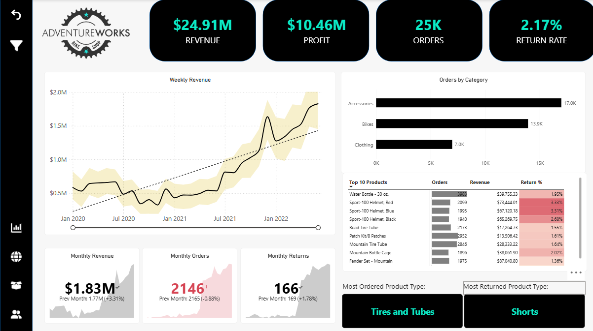
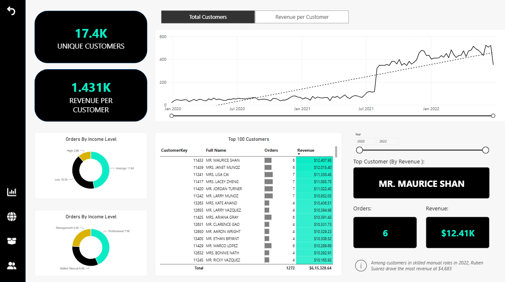
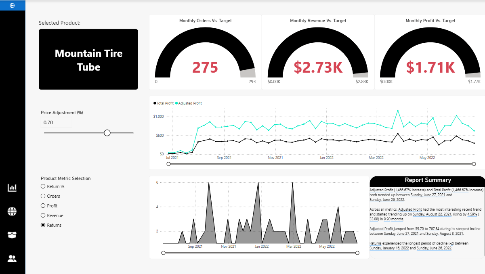

# Adventure Works – Sales Analysis
### Power BI Dashboard Project

## Dashboard Overview

### 1. Executive Dashboard

Provides a high-level overview of overall business performance through key performance indicators (KPIs) and interactive visualizations.

**Key Features:**
- Revenue, Profit, Total Orders and Return Rate KPIs.
- Weekly and Monthly Revenue Trends.
- Orders by Product Category.
- Top 10 Products Analysis based on Orders, Revenue and Return Percentage.
- Monthly Orders and Returns Analysis.
- Identification of the Most Ordered and Most Returned Product Types.

### 2. Customer Details Dashboard

Focuses on customer analysis to understand customer growth, purchasing behavior and revenue contribution.

**Key Features:**
- Total Unique Customers and Revenue per Customer.
- Customer Growth Trends over time.
- Customer Distribution across Income Levels.
- Top 100 Customers ranked by Orders and Revenue.
- Identification of the Highest Revenue-Generating Customer.
- Year-based filtering for customer analysis.

### 3. Product Details Dashboard

Provides an in-depth analysis of individual product performance, profitability and returns, with interactive options to explore different product metrics.

**Key Features:**
- Monthly Orders, Revenue and Profit compared against Targets.
- Interactive Product Selection.
- Price Adjustment Parameter to analyze adjusted profitability.
- Comparison of Total Profit and Adjusted Profit.
- Product Returns Trend Analysis.
- Dynamic Product Metric Selection.
- Automated Report Summary highlighting key performance trends.

### 4. Map Dashboard

Provides a geographical view of business activity through an interactive map, allowing users to explore different geographical regions.

**Key Features:**
- Interactive Geographic Visualization.
- Regional Filtering across Europe, North America and Pacific.
- Visual Exploration of Business Distribution across regions.

## Key Business Insights

Based on the analysis of the Adventure Works dataset, the following business insights were identified:

- **Revenue Performance:** The business generated approximately $24.91M in total revenue and $10.46M in profit.
- **Product Category Performance:** Accessories recorded the highest order volume, with approximately 17K orders.
- **Monthly Revenue Growth:** Revenue increased by 3.31% compared to the previous month, reaching $1.83M.
- **Order Trends:** Monthly orders decreased slightly by 0.88%, indicating a small decline in order volume.
- **Returns Analysis:** Monthly returns decreased by 1.78%, while the overall return rate stood at 2.17%.

These insights help understand business performance, identify product trends and monitor changes in customer purchasing activity.

## Skills Demonstrated

- **Power BI:** Creating interactive dashboards and reports.
- **Power Query:** Data cleaning and transformation.
- **DAX:** Creating measures and calculated metrics.
- **Data Visualization:** Presenting business data through charts, KPIs and maps.
- **Business Analysis:** Identifying trends and interpreting business performance.
- **Interactive Reporting:** Using slicers, filters and parameters for dynamic analysis.

